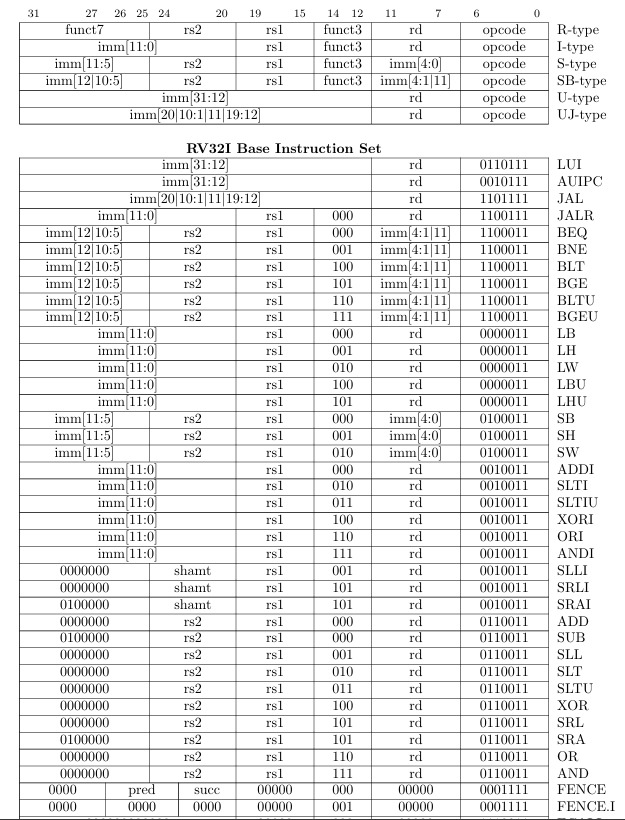
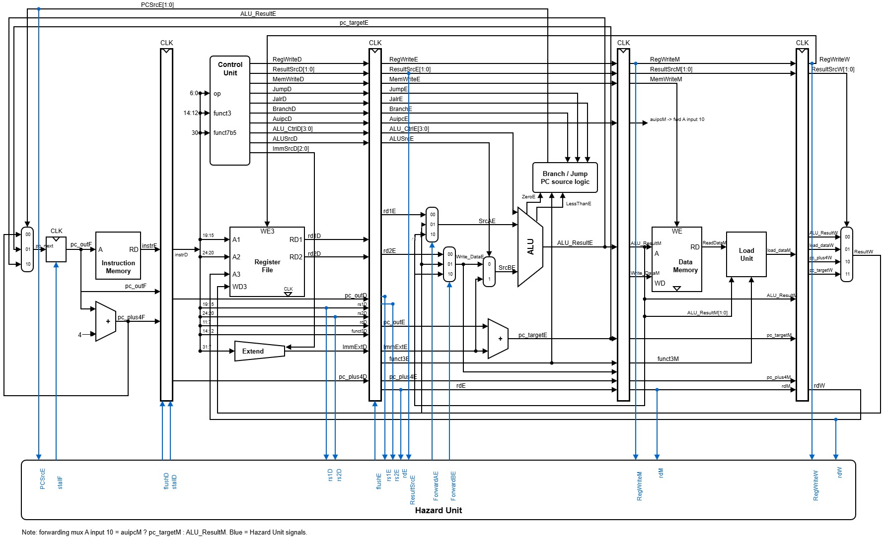

# RV32I RISC-V Processor Core (Verilog) — 5-Stage Pipelined Implementation

# Project Overview

Welcome! Continuing my journey into the heart of computer architecture, having successfully built the Single-Cycle and Multicycle variants, I have advanced the core into a high-performance **5-Stage Pipelined 32-bit RISC-V (RV32I)** processor core written entirely in Verilog HDL.

By transitioning to a pipelined architecture, the processor now overlaps the execution of multiple instructions simultaneously. This pushes the ideal Cycles Per Instruction (CPI) closer to 1, drastically increasing instruction throughput and overall maximum clock frequency ($F_{max}$) compared to previous iterations.

---

# Key Features

- **Classic 5-Stage Pipeline:** Implements the standard `Fetch (IF) -> Decode (ID) -> Execute (EX) -> Memory (MEM) -> Writeback (WB)` stages.
- **Complete RV32I Base Set:** Fully supports all 39 base integer instructions (Arithmetic, Logical, Branching, Memory, and Jumps).
- **Advanced Hazard Resolution:** Includes a dedicated Hazard Unit featuring Data Forwarding (Bypassing) and Pipeline Stalling/Flushing to seamlessly handle data and control hazards without software intervention.
- **Independent Memory Interfaces:** Utilizes separate Instruction and Data memory spaces (Harvard architecture style) to prevent structural hazards during simultaneous Fetch and Memory Access stages.
- **FPGA Ready:** Developed and optimized for hardware synthesis using modern FPGA design flows.

---

# The Instruction Set

The core handles the full 39-instruction suite of the RV32I specification:

- **Math:** `ADD`, `SUB`, `AND`, `OR`, `XOR`, `SLT` (+ Immediate versions)
- **Shifts:** `SLL`, `SRL`, `SRA` (+ Immediate)
- **Memory:** `LW` (Load Word) and `SW` (Store Word)
- **Flow Control:** `BEQ`, `BNE`, `BLT`, `BGE`, `JAL`, `JALR`
- **Upper Immediates:** `LUI`, `AUIPC`

> These are the supported instructions with address mapping:

---

### 🧱 Architecture

This repository features the **Pipelined implementation**. Pipeline registers (`IF/ID`, `ID/EX`, `EX/MEM`, `MEM/WB`) are inserted between each stage to hold the state and control signals as instructions flow through the datapath. 

A dedicated Hazard Unit monitors the pipeline registers to detect if a source register in the Decode stage depends on a result still being computed in the Execute or Memory stages, forwarding the data directly to the ALU to prevent unnecessary stalling.

> **Visualizing the Core:**
> Below is the block diagram mapping out the 5-stage datapath, the pipeline registers, the forwarding paths, and the unified hazard control logic.

---

### 🧪 Verification (How I know it works)

Hardware is only as good as its verification. This pipelined design introduces complex timing and overlapping execution scenarios, so it was rigorously simulated and verified using **AMD Xilinx Vivado**.

- **Instruction-Level Testing:** Every individual instruction was simulated via testbenches to ensure correct datapath routing and memory interactions.
- **Hazard & Dependency Verification:** Heavy focus was placed on testing back-to-back data dependencies (RAW hazards) and branch mispredictions (Control hazards). The simulation verifies that the Hazard Unit correctly forwards data, stalls the pipeline, or flushes invalid instructions precisely when needed to maintain program correctness.

---

### 🚀 What's Next? (The Roadmap)

This project is constantly evolving! With the 5-stage pipeline successfully running, the next goals for optimizing performance and capability include:

- **[Planned] Branch Prediction:** Implementing a dynamic branch predictor (like a Branch Target Buffer) to reduce the penalty of control hazard pipeline flushes.
- **[Planned] Cache Memory:** Integrating L1 Instruction and Data caches to reduce memory access latency.
- **[Planned] CSRs and Exceptions:** Adding Control and Status Registers to support hardware interrupts, exceptions, and privileged execution modes.

---

### ACKNOWLEDGEMENT

A huge thank you to **Sarah and David Harris** for their incredible textbook. It served as the perfect structural roadmap for understanding pipeline hazards and data forwarding in this implementation.
